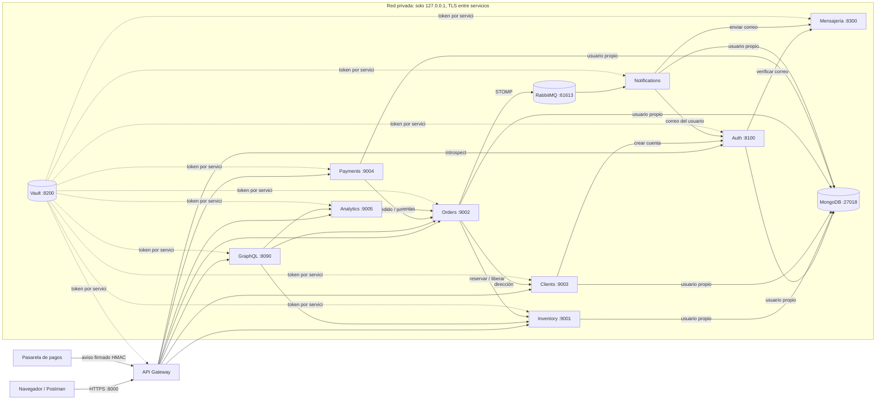
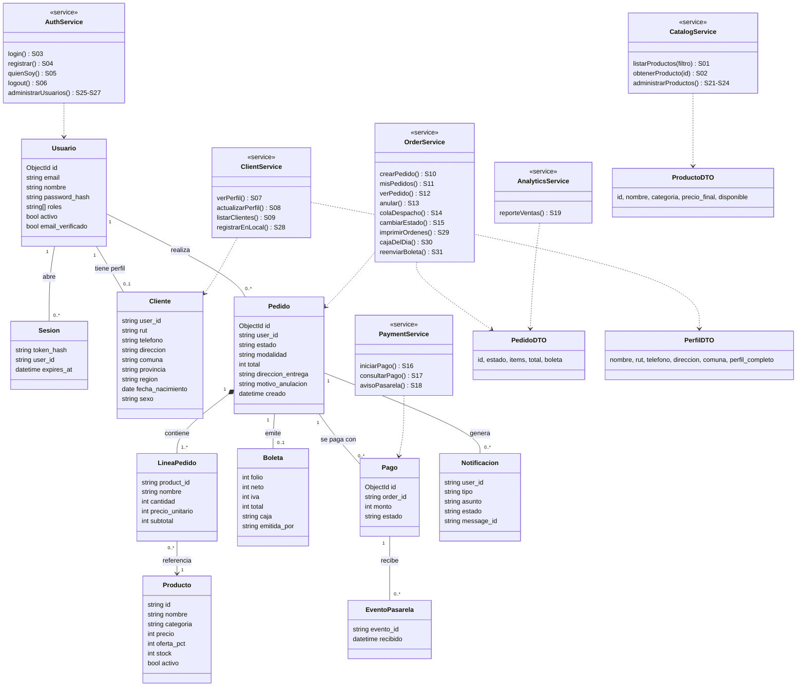
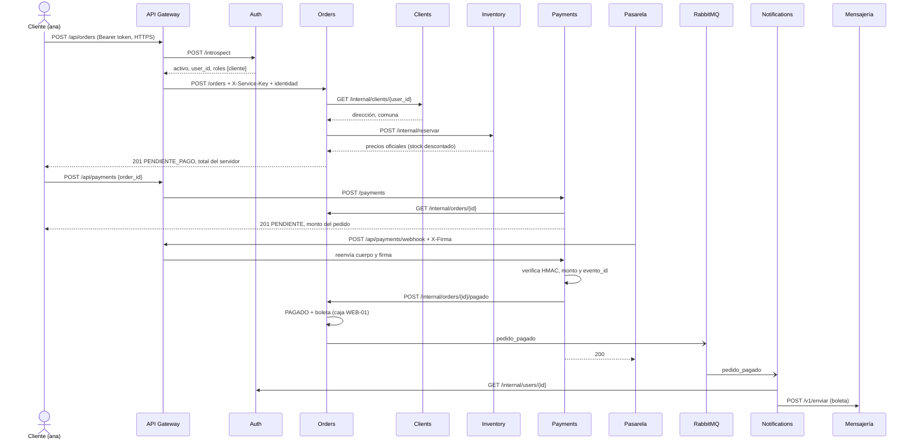
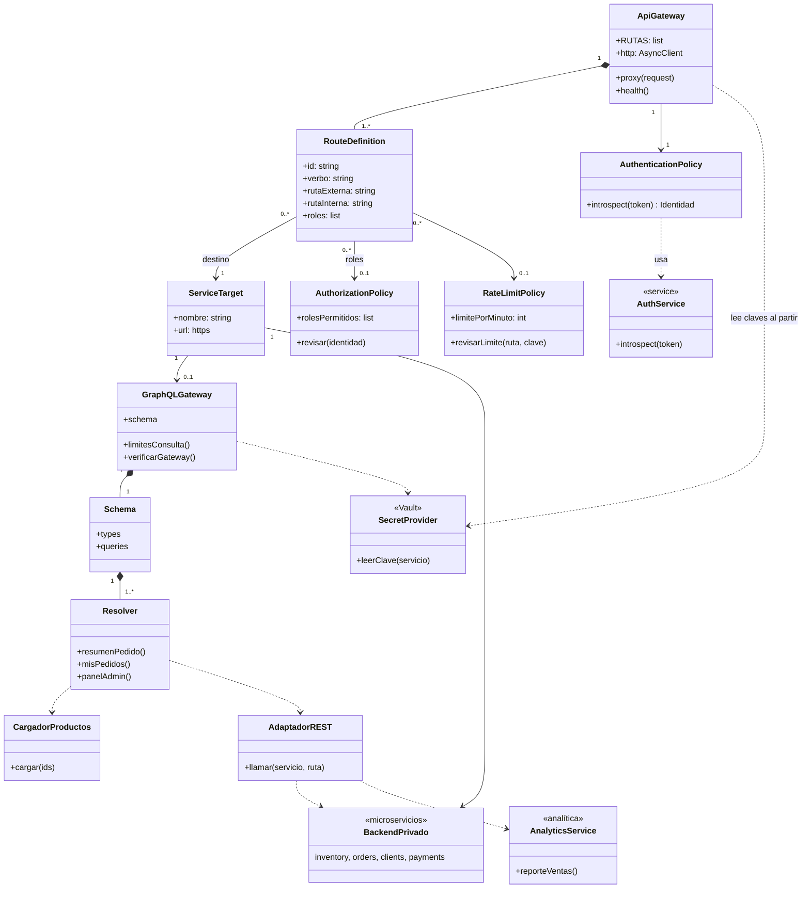

# Informe técnico: Backend seguro de Queso & Sabor

| | |
|---|---|
| Evaluación | Unidad 2: diseño e implementación de un backend seguro completo |
| Caso | 31 Queso & Sabor, tienda de quesos artesanales (requisitos del Caso 19, Sistema de Ventas On-line Fukusuke Sushi-Delivery) |
| Integrantes | Andrés Peña y Máximo Pérez |
| Versión del frontend | Evaluación 1, carpeta `../Frontend` (PHP + Bootstrap, diseño responsivo) |
| Fecha de entrega | 09 de noviembre de 2026 |

## Índice

1. [Introducción](#1-introducción)
2. [Arquitectura y tecnologías](#2-arquitectura-y-tecnologías)
3. [Requisitos y brechas](#3-requisitos-y-brechas)
4. [Módulo 1: Servicios derivados del frontend](#4-módulo-1-servicios-derivados-del-frontend)
5. [Módulo 2: Clases y cardinalidades](#5-módulo-2-clases-y-cardinalidades)
6. [Módulo 3: Sistemas e integraciones](#6-módulo-3-sistemas-e-integraciones)
7. [Módulo 4: Stakeholders y permisos HTTP](#7-módulo-4-stakeholders-y-permisos-http)
8. [Módulo 5: Clases del API Gateway](#8-módulo-5-clases-del-api-gateway)
9. [Módulo 6: Rutas y secretos de integración](#9-módulo-6-rutas-y-secretos-de-integración)
10. [Módulo 7: Datos sensibles y secretos del cliente](#10-módulo-7-datos-sensibles-y-secretos-del-cliente)
11. [Módulo 8: Separación privada y GraphQL](#11-módulo-8-separación-privada-y-graphql)
12. [Módulo 9: Analítica y gRPC](#12-módulo-9-analítica-y-grpc)
13. [Módulo 10: Backend completo y pruebas](#13-módulo-10-backend-completo-y-pruebas)
14. [Conclusión](#14-conclusión)
15. [Anexo A: Ejecución](#anexo-a-ejecución)
16. [Anexo B: Usuarios de prueba](#anexo-b-usuarios-de-prueba)

## 1. Introducción

Queso & Sabor es una quesería con tres locales en Santiago que busca vender en línea. Este informe documenta el diseño y la implementación del backend del sistema de ventas: catálogo, registro y autenticación de clientes, pedidos con despacho o retiro, pago mediante una pasarela externa, boleta digital enviada por correo, órdenes de despacho, caja web y reportes de ventas.

El principio que guía el diseño es que el navegador nunca es una fuente confiable. Los precios, los montos, la identidad, los roles y el estado de cada pedido los decide siempre el servidor. La seguridad se aplica en capas: un API Gateway como única entrada pública, TLS en todas las comunicaciones HTTP, una clave de servicio distinta por sistema, un token de Vault con permisos mínimos por servicio, un usuario de base de datos por servicio y verificación de propiedad del recurso dentro de cada microservicio.

Los diagramas están escritos en Mermaid, un formato de texto editable que GitHub y VS Code (con la extensión *Markdown Preview Mermaid Support*) dibujan directamente.

## 2. Arquitectura y tecnologías

| Componente | Tecnología |
|---|---|
| API Gateway y microservicios | Python 3.12, FastAPI y uvicorn |
| GraphQL Gateway | Node.js con Express y Apollo Server |
| Persistencia | MongoDB 8 en Docker, con autenticación y un usuario por servicio |
| Gestión de secretos | HashiCorp Vault (KV v2, políticas y tokens por servicio, TLS) |
| Mensajería asíncrona | RabbitMQ 3.13 con STOMP, en Docker |
| Proveedor de correo | Adaptador de prueba con el contrato del proveedor (`mensajeria/`) |
| Pasarela de pagos | Simulador que firma los avisos con HMAC (`scripts/pasarela_simulada.py`) |
| Transporte | TLS en todas las llamadas HTTP, con una CA local (`scripts/generar_certificados.py`) |
| Pruebas | Postman y newman, más scripts de carga, fallos y aislamiento |

Dependencias versionadas en `requirements.txt` (fastapi, uvicorn, httpx, pydantic, motor, pymongo, stomp.py, cryptography, psutil) y en `graphql/package.json` (express 4, apollo-server-express 3, graphql).



Solo el gateway escucha en `0.0.0.0`. Los servicios, Vault, MongoDB y RabbitMQ escuchan en `127.0.0.1`; los dos últimos corren en Docker con sus puertos publicados únicamente en la interfaz local.

## 3. Requisitos y brechas

Requisitos funcionales del Caso 19 adaptados a la quesería:

| ID | Requisito | Servicios | Estado |
|---|---|---|---|
| RF1 | Armar un pedido con los productos disponibles | S01, S02, S10 a S12, S20 | implementado |
| RF2 | Preparar la orden solo después de confirmado el pago | S15, S18 | implementado |
| RF3 | Anular una compra indicando el motivo | S13 | implementado |
| RF4 | Vender solo a clientes registrados; ventas asociadas a una caja operada por un cajero virtual | S10, S16, S18, S30 | implementado |
| RF5 | Registro de clientes con RUN, nombre, dirección, comuna, provincia, región, fecha de nacimiento, sexo, correo y teléfono | S04, S07, S08 | implementado |
| RF6 | Registro de clientes en el local por el administrador | S28 | implementado |
| RF7 | Consultar y actualizar la disponibilidad de los productos | S01, S21 a S24 | implementado |
| RF8 | Boleta digital por cada venta, emitida por el cajero virtual y enviada por correo | S18, S31, notificaciones | implementado |
| RF9 | Reporte de ventas por período para el dueño | S19, S20 | implementado |
| RF10 | Mantenedores de productos, usuarios y clientes | S09, S21 a S28 | implementado |
| RF11 | Validar con una API de mensajería que el correo exista y esté activo | S04, S26, S28 | implementado |
| RF12 | Acceso según el perfil asignado por el administrador | S03, S05, S06, S26 | implementado |
| RF13 | Imprimir las órdenes de despacho en orden de llegada | S14, S15, S29 | implementado |
| Pago | Pago mediante plataforma externa | S16 a S18 | implementado con simulador |
| Despacho | Despacho gratuito dentro del radio del local | S10 | implementado (comunas Providencia, Ñuñoa, Las Condes y Santiago) |

Brechas y limitaciones declaradas:

- **Datos del frontend, sin integración.** Por indicación del docente, esta entrega se construye con los datos del frontend y no con el frontend integrado. El catálogo, las ofertas (con el mismo precio final redondeado a la decena), las categorías, los locales de retiro y los campos de los formularios de login y registro son los de las pantallas de la Evaluación 1. Las pantallas P07 a P12 están diseñadas en este informe pero no construidas. Todas las operaciones están disponibles en el gateway y se prueban con Postman.
- **Proveedores externos.** No se dispone de cuentas de prueba de una pasarela de pagos ni de un proveedor de correo. Se entregan adaptadores de prueba que conservan el contrato, la autenticación (firma HMAC y API key) y las transiciones; los correos quedan como archivos `.eml` en `mensajeria/enviados/`.
- **Ambiente local.** Vault corre en modo desarrollo (datos en memoria) y MongoDB guarda sus datos en memoria del contenedor, por lo que cada arranque parte de cero y se recarga con los scripts. La caja diaria se calcula en horario UTC.

## 4. Módulo 1: Servicios derivados del frontend

Pantallas existentes: P01 Inicio (`Index.php`), P02 Catálogo (`catalogo.php`), P03 Ofertas (`Ofertas.php`), P04 Carrito (`Carrito.php`), P05 Contacto, P06 Locales, M01 modal de inicio de sesión y M02 modal de registro. Pantallas propuestas: P07 Mi perfil, P08 Mis pedidos, P09 Administración de productos, P10 Administración de clientes y usuarios, P11 Despacho, P12 Reportes y caja. Escritorio y móvil comparten el mismo HTML con Bootstrap, por lo que la variación visual no genera servicios distintos.

Acciones que no requieren servicio: agregar al carro y cambiar cantidades (el carrito vive en el navegador y no es confiable: al confirmar, el servidor recalcula todo), filtrar por categoría (se filtra la lista cargada o se usa `?categoria=`), la pantalla de Locales (contenido fijo) y el formulario de contacto (no forma parte de los requisitos del caso).

Frontera entre navegador y servidor:

| El navegador envía (no confiable) | El servidor calcula o decide |
|---|---|
| `product_id` y `cantidad` | precio unitario con oferta, subtotal y total (inventory) |
| `modalidad` y `local_retiro` | dirección de entrega (desde el perfil en clients) y si la comuna tiene despacho |
| `order_id` al pagar | monto del pago (desde el pedido) y estado del pago (solo con aviso firmado) |
| ningún dato de identidad | `user_id` y roles, obtenidos del token validado por el gateway |
| `estado` de destino (personal de despacho) | si la transición es válida |
| correo al registrarse | si el correo existe y está activo (API de mensajería) |

Si el navegador agrega campos como `precio_unitario`, `total`, `estado`, `monto` o `roles`, pydantic los descarta. Las carpetas 03, 06 y 07 de la colección de Postman lo comprueban.

Catálogo de servicios. Acceso: *anónimo* o el rol requerido. Todos los errores tienen la forma `{"detail": "..."}`.

| ID | Req. | Pantalla y acción | Propósito | Verbo y ruta | Entrada | Salida | Reglas y errores | Datos | Acceso |
|---|---|---|---|---|---|---|---|---|---|
| S01 | RF1, RF7 | P02 y P03, cargar productos | Mostrar el catálogo vigente | GET `/api/products` | query opcional: `categoria` (madurado, fresco, especial), `q`, `en_oferta`, `ids` | 200 lista `{id, nombre, categoria, descripcion, precio, oferta_pct, precio_final, disponible}` | 422 filtro inválido; solo productos activos; nunca el stock exacto | público | anónimo |
| S02 | RF1 | P02, ver producto | Detalle de un producto | GET `/api/products/{id}` | id | 200 producto público | 404 si no existe o está de baja | público | anónimo |
| S03 | RF12 | M01, Ingresar | Abrir una sesión | POST `/api/auth/login` | `email`, `password` | 200 `{access_token, token_type, expires_in}` | 401 mismo mensaje si el correo no existe o la clave es incorrecta; 403 usuario desactivado; 429 tras 5 intentos por minuto | credencial | anónimo |
| S04 | RF4, RF5, RF11 | M02, Registrarse | Crear una cuenta de cliente | POST `/api/auth/register` | `email`, `nombre`, `password` (8 o más, letras y números) | 201 `{user_id, email, roles}` | 409 correo repetido; 422 contraseña débil o correo inexistente/inactivo; 503 si no se puede validar el correo; el rol siempre es cliente | personal, credencial | anónimo |
| S05 | RF12 | Encabezado, "Hola, nombre" | Identificar la sesión | GET `/api/auth/me` | token | 200 `{user_id, email, nombre, roles, expires_at}` | 401 token inválido o vencido | personal propio | autenticado |
| S06 | RF12 | Encabezado, Cerrar sesión | Revocar el token | POST `/api/auth/logout` | token | 200 `{message}` | el token deja de servir | credencial | autenticado |
| S07 | RF5 | P07, ver perfil | Consultar los datos propios | GET `/api/clients/me` | token | 200 perfil completo y `perfil_completo` | solo el propio perfil | personal | cliente |
| S08 | RF5 | P07, Guardar; P04 si falta dirección | Completar o modificar el perfil | PUT `/api/clients/me` | `nombre`; opcionales `rut` (12345678-5), `telefono` (+569…), `direccion`, `comuna`, `provincia`, `region`, `fecha_nacimiento` (AAAA-MM-DD), `sexo` (F, M, Otro, No informa) | 200 perfil | 422 RUT con dígito verificador incorrecto, fecha futura o sexo fuera de las opciones; 409 RUT de otro cliente | personal | cliente |
| S09 | RF10 | P10, listar clientes | Gestionar clientes | GET `/api/admin/clients` | `skip`, `limit` | 200 lista `{user_id, nombre, email, rut enmascarado, comuna}` | sin teléfono ni dirección | personal mínimo | admin |
| S10 | RF1, RF4 | P04, Confirmar pedido | Crear el pedido con precios oficiales | POST `/api/orders` | `items[]` 1 a 30 `{product_id, cantidad 1 a 20}`, `modalidad` DESPACHO o RETIRO, `local_retiro` si es retiro | 201 pedido `PENDIENTE_PAGO` con precios y total del servidor | 400 productos repetidos, perfil sin dirección, comuna fuera del radio o local inválido; 404 producto; 409 sin stock; 503 si inventory o clients no responden (el pedido no se crea) | personal (dirección) | cliente |
| S11 | RF1 | P08, mis pedidos | Historial propio | GET `/api/orders/mine` | `skip`, `limit` | 200 lista de pedidos propios | solo los del usuario del token | personal | cliente |
| S12 | RF1, RF13 | P08 y P11, ver pedido | Detalle y seguimiento | GET `/api/orders/{id}` | id | 200 pedido; despacho y admin ven además los datos de entrega | 404 si es ajeno (no revela que existe) | personal | cliente dueño, admin, despacho |
| S13 | RF3 | P08, Anular | Anular con motivo sin borrar | POST `/api/orders/{id}/cancel` | `motivo` 5 a 300 caracteres | 200 pedido `ANULADO`, `reembolso_pendiente` si estaba pagado | 404 ajeno; 409 si ya está en preparación o anulado; 503 si inventory no devuelve el stock (no se anula) | personal | cliente dueño, admin |
| S14 | RF13 | P11, cola de despacho | Atender en orden de llegada | GET `/api/admin/orders` | `estado` opcional | 200 pedidos del más antiguo al más nuevo, con datos de entrega | | personal | admin, despacho |
| S15 | RF2, RF13 | P11, Avanzar estado | Registrar el avance del pedido | PATCH `/api/admin/orders/{id}/estado` | `estado` | 200 pedido | 409 si no es el siguiente estado; solo se prepara lo pagado | personal | admin, despacho |
| S16 | Pago | P04, Pagar | Iniciar el cobro | POST `/api/payments` | `order_id` | 201 `{payment_id, order_id, monto, estado: PENDIENTE}` | 404 pedido ajeno; 409 pedido no pendiente; reutiliza un pago pendiente | negocio | cliente |
| S17 | Pago | P08, estado del pago | Consultar el pago | GET `/api/payments/{id}` | id | 200 pago | 404 ajeno | negocio | cliente dueño, admin |
| S18 | Pago, RF8 | Pasarela (sin pantalla) | Recibir el resultado del pago | POST `/api/payments/webhook` | cabecera `X-Firma`; `{evento_id, payment_id, estado, monto}` | 200 `{duplicado, estado}` | 401 firma inválida; 400 monto distinto; un aviso repetido no se procesa dos veces | negocio | pasarela (firma) |
| S19 | RF9 | P12, reporte | Ventas por período | GET `/api/analytics/ventas` | `desde`, `hasta` opcionales (AAAA-MM-DD) | 200 `{pedidos_pagados, total_vendido, ticket_promedio, ventas_por_dia, productos_mas_vendidos}` | 400 si desde es mayor que hasta; sin datos personales | negocio | admin, dueño |
| S20 | RF1, RF9 | P08 y P12, resúmenes | Agregaciones para pantallas | POST `/api/graphql` | consulta GraphQL | ver Módulo 8 | autorización por campo y límites de costo | según campo | autenticado |
| S21 | RF7 | P09, listar con stock | Revisar disponibilidad | GET `/api/admin/products` | `bajo_stock` opcional | 200 productos con `stock` y `activo` | incluye los dados de baja | negocio | admin, dueño |
| S22 | RF10 | P09, Nuevo producto | Agregar al catálogo | POST `/api/admin/products` | `id`, `nombre`, `categoria`, `descripcion`, `precio`, `oferta_pct`, `stock` | 201 producto | 409 id repetido; 422 | negocio | admin |
| S23 | RF7, RF10 | P09, Guardar | Actualizar precio, oferta o stock | PUT `/api/admin/products/{id}` | mismo cuerpo sin id | 200 producto | 404 | negocio | admin |
| S24 | RF10 | P09, Dar de baja | Retirar del catálogo | DELETE `/api/admin/products/{id}` | id | 200 `{id, activo: false}` | baja lógica: el historial conserva nombre y precio | negocio | admin |
| S25 | RF10 | P10, listar usuarios | Gestionar al personal | GET `/api/admin/users` | | 200 usuarios sin hash | | personal | admin |
| S26 | RF10, RF12 | P10, Nuevo usuario | Crear personal y asignar perfil | POST `/api/admin/users` | `email`, `nombre`, `password`, `roles` (admin, despacho, dueno, cajero) | 201 `{user_id, email, roles}` | 409 correo repetido; 422 rol no permitido o correo inexistente | credencial | admin |
| S27 | RF10 | P10, Desactivar | Quitar el acceso | DELETE `/api/admin/users/{id}` | id | 200 `{user_id, activo: false}` | no borra; cierra sus sesiones; 400 si es la propia cuenta | personal | admin |
| S28 | RF6, RF11 | P10, Registrar cliente en el local | Alta presencial de un cliente | POST `/api/admin/clients` | `email`, `password`, `nombre` y los campos de S08 | 201 perfil | 422 correo inexistente o datos inválidos; 409 correo o RUT repetido | personal, credencial | admin |
| S29 | RF13 | P11, Imprimir órdenes | Entregar las órdenes a cocina | GET `/api/admin/orders/imprimir` | `estado` PAGADO (por defecto) o EN_PREPARACION | 200 página HTML imprimible en orden de llegada | datos escapados; solo personal de despacho | personal | admin, despacho |
| S30 | RF4 | P12, Caja del día | Consultar lo recaudado por la caja web | GET `/api/admin/caja` | `fecha` opcional (AAAA-MM-DD) | 200 `{caja, fecha, ventas[], cantidad, total_recaudado, reembolsos_pendientes}` | 422 fecha inválida; sin datos personales | negocio | admin, cajero, dueño |
| S31 | RF8 | P12, Reenviar boleta | Volver a enviar la boleta al cliente | POST `/api/admin/orders/{id}/boleta` | id | 200 `{order_id, folio, reenviada}` | 409 si el pedido no tiene boleta | negocio | admin, cajero |

Ejemplos con datos ficticios:

```json
POST /api/orders   (S10, token de ana; el precio enviado se ignora)
{"items": [{"product_id": "chanco-ahumado", "cantidad": 2, "precio_unitario": 1}], "modalidad": "DESPACHO"}

201
{"id": "6aecb2ae85776a588fabeb7d", "estado": "PENDIENTE_PAGO", "modalidad": "DESPACHO",
 "items": [{"product_id": "chanco-ahumado", "nombre": "Chanco Ahumado", "cantidad": 2,
            "precio_unitario": 4390, "subtotal": 8780}],
 "total": 8780, "creado": "2026-11-07T16:40:12+00:00", "boleta": null,
 "direccion_entrega": "Av. Providencia 1234, depto 5, Providencia"}
```

```json
POST /api/payments/webhook   (S18, enviado por la pasarela con X-Firma: HMAC-SHA256 del cuerpo)
{"evento_id": "evt-5b1f0c", "payment_id": "6aecb2aefd366e9261dc90d7", "estado": "APROBADO", "monto": 8780}

200
{"duplicado": false, "estado": "APROBADO"}
```

```json
PUT /api/clients/me   (S08)
{"nombre": "Ana Rojas", "rut": "11111111-1", "telefono": "+56911112222", "direccion": "Av. Providencia 1234",
 "comuna": "Providencia", "provincia": "Santiago", "region": "Metropolitana de Santiago",
 "fecha_nacimiento": "1995-04-12", "sexo": "F"}

200
{"user_id": "6aef...", "email": "ana@quesoysabor.cl", "nombre": "Ana Rojas", "rut": "11111111-1", ...,
 "fecha_nacimiento": "1995-04-12", "sexo": "F", "perfil_completo": true}
```

```json
GET /api/admin/caja?fecha=2026-11-07   (S30, token del cajero)
200
{"caja": "WEB-01", "operada_por": "cajero virtual", "fecha": "2026-11-07",
 "ventas": [{"folio": 1, "order_id": "6aecb2ae85776a588fabeb7d", "total": 8780, "hora": "16:41", "estado": "PAGADO"}],
 "cantidad": 1, "total_recaudado": 8780, "reembolsos_pendientes": 0}
```

## 5. Módulo 2: Clases y cardinalidades



Leyenda: la línea simple es una asociación; el rombo lleno es composición; la flecha continua es una asociación navegable; la flecha punteada es una dependencia UML (el servicio usa ese contrato o esa clase, lo que no implica una relación entre registros de negocio). Las multiplicidades se leen en cada extremo. Las clases `«service»` corresponden a los servicios públicos y cada operación indica su ID del Módulo 1.

| Origen | Destino | Multiplicidad | Regla que la justifica |
|---|---|---|---|
| Usuario | Sesion | 1 a 0..* | Un usuario puede tener varias sesiones abiertas (celular y computador); cada sesión pertenece a un solo usuario. |
| Usuario | Cliente | 1 a 0..1 | Solo los clientes tienen perfil y se crea al guardarlo por primera vez (S08) o en el registro presencial (S28). El personal no tiene perfil. |
| Usuario | Pedido | 1 a 0..* | Un cliente puede no haber comprado nunca; cada pedido es de un solo cliente. |
| Pedido | LineaPedido | 1 a 1..* | No existen pedidos vacíos: S10 exige al menos un ítem. La línea no existe sin su pedido (composición). |
| LineaPedido | Producto | 0..* a 1 | Cada línea apunta a un producto. La línea copia nombre y precio, así el historial no cambia si el producto cambia de precio o se da de baja. |
| Pedido | Boleta | 1 a 0..1 | La boleta se emite solo al confirmarse el pago; un pedido anulado antes de pagar no tiene boleta. |
| Pedido | Pago | 1 a 0..* | Puede haber un pago rechazado y luego uno aprobado; solo uno queda aprobado. |
| Pago | EventoPasarela | 1 a 0..* | La pasarela puede reenviar un aviso; cada `evento_id` se registra una sola vez. |
| Pedido | Notificacion | 1 a 0..* | Cada pago, cambio de estado, anulación o reenvío de boleta genera un correo. |

Decisiones del modelo: el carrito y el pedido son conceptos distintos; el carrito vive en el navegador y el pedido existe recién al confirmar. Hacia el frontend solo salen DTO: `ProductoDTO` no incluye el stock exacto, `PedidoDTO` no incluye el `user_id` para el cliente y el listado administrativo de clientes no incluye teléfono ni dirección. La boleta forma parte del pedido porque se emite una sola vez sobre el mismo documento.

## 6. Módulo 3: Sistemas e integraciones

| Sistema | Responsabilidad | Datos que administra | Servicios | Depende de | Contrato de integración | Credencial o identidad | Respuesta ante fallos |
|---|---|---|---|---|---|---|---|
| auth | Identidad, sesiones, usuarios y validación de correos | usuarios, sesiones | S03 a S06, S25 a S27 | MongoDB, mensajería | REST `/login`, `/register`, `/introspect`, `/internal/users/{id}` | clave `auth`; API key de mensajería | sin auth nadie entra (502, falla cerrado); sin mensajería no se crean cuentas (503) |
| inventory | Catálogo, precios, ofertas y stock; autoridad del precio y del stock | productos | S01, S02, S21 a S24 | MongoDB | REST, más `/internal/reservar` y `/internal/liberar` | clave `inventory` | no se crean pedidos (503) y el catálogo responde 502 |
| clients | Perfil del cliente y registro presencial | clientes | S07 a S09, S28 | MongoDB, auth | REST, más `/internal/clients/{id}` | clave `clients`; clave `auth` para crear cuentas | sin clients no se crean pedidos con despacho (503) |
| orders | Pedidos, transiciones, despacho, boleta y caja web; autoridad del estado del pedido | pedidos, contadores, avisos_pendientes | S10 a S15, S29 a S31 | inventory, clients, broker | REST, más `/internal/orders/...`; evento STOMP | clave `orders`; usuario del broker | sin inventory el pedido no se crea; sin broker la venta sigue y el aviso se reenvía al volver |
| payments | Inicio del pago y verificación del aviso de la pasarela | pagos, eventos_pasarela | S16 a S18 | orders | REST y webhook firmado con HMAC | clave `payments`; `webhook_secret` | si orders no confirma, el evento se elimina para que la pasarela reintente (502) |
| analytics | Reportes de ventas | ninguno | S19 | orders | REST `/internal/ventas` | clave `analytics` | 503; el resto del sistema sigue |
| graphql | Agregaciones para pantallas | ninguno | S20 | orders, inventory, analytics | GraphQL | clave `graphql` | respuesta parcial con error en el campo afectado |
| notifications | Arma y envía los correos (boleta, estados, anulación) | bandeja_salida | asíncrono | broker, auth, mensajería | cola STOMP `/queue/pedidos` | usuario del broker; claves `auth` y de mensajería | los mensajes esperan en la cola; se reconecta solo; si el correo falla, reintenta |
| Pasarela de pagos (externo) | Cobrar y avisar el resultado | | S18 | | aviso firmado | `webhook_secret` | el pago queda PENDIENTE |
| Mensajería (externo, adaptador de prueba) | Verificar correos y enviarlos | correos enviados | S04, S26, S28 y avisos | | REST `/v1/verificar`, `/v1/enviar` | API key `mensajeria` | registro en 503; correos en reintento |

Cada sistema es dueño de sus datos y solo él los modifica. orders no descuenta stock en la base de inventory, sino que le solicita la reserva; payments no cambia el estado del pedido, sino que se lo notifica a orders; clients no crea cuentas, sino que se lo pide a auth. No se separó un servicio por tabla: despacho, boleta y caja quedaron dentro de orders porque modifican o leen el mismo documento del pedido, y separarlos obligaría a coordinar dos servicios en cada pago.

Consistencia del stock: inventory reserva con `find_one_and_update` y la condición `stock >= cantidad`, por lo que dos compras simultáneas no pueden dejar el stock negativo (comprobado con 10 compras concurrentes sobre un stock de 2: se crean exactamente 2 pedidos). Si falla un producto, se devuelve lo descontado de ese pedido. Al anular, orders solo marca `ANULADO` si inventory confirmó la devolución.

Consistencia de los avisos: si el broker no responde, orders guarda el evento en `avisos_pendientes` y una tarea lo reenvía cada 15 segundos. El consumidor confirma (*ack*) cada mensaje solo después de enviar el correo; si auth o la mensajería fallan, devuelve el mensaje a la cola.

Secuencia de una compra con despacho:



## 7. Módulo 4: Stakeholders y permisos HTTP

| Stakeholder | Interés | Rol o identidad | Uso de la información |
|---|---|---|---|
| Visitante | Ver quesos, ofertas y precios | ninguno (anónimo) | Solo el catálogo público |
| Cliente | Comprar y seguir sus pedidos | `cliente` | Sus datos, sus pedidos y sus pagos |
| Administrador | Mantener productos, clientes y personal | `admin` | Gestión completa, clientes con RUT enmascarado |
| Encargado de despacho | Preparar y entregar los pedidos en orden | `despacho` | Pedidos, datos de entrega y órdenes impresas |
| Cajero virtual (funcionario) | Responder por las ventas de la caja web | `cajero` | Caja del día y reenvío de boletas, sin datos personales |
| Dueño | Conocer las ventas y retirar lo recaudado | `dueno` | Reportes, caja y stock, sin datos personales |
| Pasarela de pagos | Informar el resultado del pago | identidad técnica (firma HMAC) | Solo S18 |
| Proveedor de mensajería | Verificar y entregar correos | identidad técnica (API key del comercio) | Recibe el correo del destinatario y el texto del aviso |
| Repartidor | Llevar el pedido | sin permisos operativos | Recibe la orden de despacho impresa del encargado |
| Cocina | Preparar el pedido | sin permisos operativos | Recibe las órdenes impresas (S29) en orden de llegada |
| Contador | Llevar la contabilidad | sin permisos operativos | Recibe el reporte de ventas y la caja que le entrega el dueño |

Identidades técnicas: cada servicio se autentica ante otro con la `X-Service-Key` del destino y ante Vault con su propio token. La autenticación (quién es) la resuelve auth a partir del token; la autorización (qué puede hacer) se revisa dos veces: el gateway por ruta, verbo y rol, y cada servicio por rol, propiedad del recurso y estado.

Matriz de permisos. P: permitido; D: denegado; N/A: no aplica. Un verbo permitido aplica solo a la ruta indicada.

| Servicio | Ruta | Verbo | Visitante | Cliente | Admin | Despacho | Cajero | Dueño | Alcance y condición | Se verifica en |
|---|---|---|---|---|---|---|---|---|---|---|
| S01, S02 | /api/products | GET | P | P | P | P | P | P | solo campos públicos | gateway (ruta pública) e inventory |
| S03 | /api/auth/login | POST | P | P | P | P | P | P | 5 intentos por minuto por IP y correo | gateway (límite) y auth |
| S04 | /api/auth/register | POST | P | N/A | N/A | N/A | N/A | N/A | correo verificado; rol siempre cliente | gateway (límite) y auth |
| S05, S06 | /api/auth/me, /logout | GET, POST | D | P | P | P | P | P | token válido | gateway |
| S07, S08 | /api/clients/me | GET, PUT | D | P | D | D | D | D | solo el propio perfil (user_id del token) | gateway y clients |
| S09 | /api/admin/clients | GET | D | D | P | D | D | D | RUT enmascarado, sin contacto | gateway y clients |
| S28 | /api/admin/clients | POST | D | D | P | D | D | D | correo verificado; RUT único | gateway, clients y auth |
| S10 | /api/orders | POST | D | P | D | D | D | D | perfil completo para despacho | gateway y orders |
| S11 | /api/orders/mine | GET | D | P | D | D | D | D | solo los propios | gateway y orders |
| S12 | /api/orders/{id} | GET | D | P | P | P | D | D | cliente solo si el pedido es suyo | gateway y orders |
| S13 | /api/orders/{id}/cancel | POST | D | P | P | D | D | D | cliente solo el suyo; estado PENDIENTE_PAGO o PAGADO | gateway y orders |
| S14 | /api/admin/orders | GET | D | D | P | P | D | D | orden de llegada | gateway y orders |
| S15 | /api/admin/orders/{id}/estado | PATCH | D | D | P | P | D | D | solo el siguiente estado | gateway y orders |
| S29 | /api/admin/orders/imprimir | GET | D | D | P | P | D | D | pedidos pagados o en preparación | gateway y orders |
| S30 | /api/admin/caja | GET | D | D | P | D | P | P | sin datos personales | gateway y orders |
| S31 | /api/admin/orders/{id}/boleta | POST | D | D | P | D | P | D | solo pedidos con boleta | gateway y orders |
| S16 | /api/payments | POST | D | P | D | D | D | D | el pedido debe ser suyo y estar pendiente | gateway y payments |
| S17 | /api/payments/{id} | GET | D | P | P | D | D | D | cliente solo el suyo | gateway y payments |
| S18 | /api/payments/webhook | POST | D | D | D | D | D | D | solo la pasarela, con firma HMAC válida; 30 avisos por minuto | payments |
| S19 | /api/analytics/ventas | GET | D | D | P | D | D | P | período válido | gateway y analytics |
| S20 | /api/graphql | POST | D | P | P | P | P | P | autorización por campo (Módulo 8) | gateway y graphql |
| S21 | /api/admin/products | GET | D | D | P | D | D | P | incluye stock | gateway e inventory |
| S22 a S24 | /api/admin/products | POST, PUT, DELETE | D | D | P | D | D | D | DELETE es baja lógica | gateway e inventory |
| S25 a S27 | /api/admin/users | GET, POST, DELETE | D | D | P | D | D | D | no puede desactivarse a sí mismo | gateway y auth |

Anular no es borrar: el pedido queda `ANULADO` con su motivo y, si estaba pagado, con `reembolso_pendiente`. Ningún rol puede eliminar pedidos, porque el historial y las boletas deben conservarse. Ocultar un botón en el frontend no reemplaza estos controles: todas las reglas se aplican en el backend.

## 8. Módulo 5: Clases del API Gateway

Se utiliza un único API Gateway. Las rutas públicas, de cliente, administrativas y el webhook se diferencian por la política de cada ruta, y todas comparten la misma validación de token, por lo que un segundo gateway no aportaría aislamiento adicional. El GraphQL Gateway es un componente distinto y privado: solo recibe llamadas del API Gateway.



Las relaciones de rombo y de flecha continua son estructurales (qué contiene o referencia qué). Las punteadas son dependencias de uso. El flujo de red está en el mapa de componentes de la sección 2, que complementa este diagrama. En el código, `RUTAS` de `gateway/gateway.py` es la lista de RouteDefinition; `introspect()` es la AuthenticationPolicy; la comparación de roles en `proxy()` es la AuthorizationPolicy; `revisar_limite()` es la RateLimitPolicy; `SERVICIOS` son los ServiceTarget, y `leer_claves_vault()` es el SecretProvider.

Fronteras de confianza:

1. **Internet a gateway.** No se confía en nada de lo que envía el navegador. El gateway termina TLS, valida el token con auth, revisa ruta, verbo y rol, aplica límites de intentos y arma desde cero las cabeceras internas. Las cabeceras `X-Authenticated-*` o `X-Service-Key` que envíe el navegador se descartan, porque el gateway no copia cabeceras del request original salvo `Content-Type` (y `X-Firma` en el webhook).
2. **Gateway a servicios.** Cada servicio exige su propia `X-Service-Key`, comparada en tiempo constante, y escucha solo en `127.0.0.1` con TLS. Una llamada directa sin clave recibe 403.
3. **Dentro de cada servicio.** Aunque la llamada venga del gateway, el servicio vuelve a revisar el rol, la propiedad del recurso, el estado y los datos de entrada (pydantic y validadores de MongoDB).

El gateway valida identidad, ruta, verbo, rol y límites, con tiempos máximos de 5 s para auth y 10 s para los demás servicios, mensajes de error controlados y registros sin secretos. La redirección no es genérica: solo se aceptan las 31 rutas y verbos de la tabla, y los parámetros de ruta deben cumplir `[A-Za-z0-9_-]{1,64}`.

Recorrido autorizado: ana pide `GET /api/orders/{id}` de su pedido. El gateway encuentra la ruta G16, valida el token con auth, comprueba que el rol cliente está permitido y llama a orders con la clave de orders y la identidad de ana. orders verifica que el `user_id` del pedido es el de ana y responde 200.

Recorrido denegado: pedro pide el mismo pedido. El gateway lo deja pasar porque pedro también es cliente, pero orders comprueba que el pedido no es suyo y responde 404 sin datos. Si pedro intenta `POST /api/admin/products`, el gateway responde 403 antes de llegar a inventory.

## 9. Módulo 6: Rutas y secretos de integración

Matriz de rutas. Todas pasan por el API Gateway (`https://<host>:8000`). Lo que no está en la tabla responde 404, o 405 si la ruta existe con otro verbo. Las rutas `/internal/...` no se publican.

| ID | Servicio | Verbo | Ruta externa | Acceso y rol | Sistema y ruta destino | Controles | Credencial del tramo |
|---|---|---|---|---|---|---|---|
| G01 | S03 | POST | /api/auth/login | anónimo | auth POST /login | 5 por minuto por IP y correo | auth.service_key |
| G02 | S04 | POST | /api/auth/register | anónimo | auth POST /register | 5 por minuto por IP; correo verificado | auth.service_key |
| G03 | S06 | POST | /api/auth/logout | autenticado | auth POST /logout (el gateway arma el cuerpo con el token) | token | auth.service_key |
| G04 | S05 | GET | /api/auth/me | autenticado | respondida por el gateway con la identidad verificada | token | auth.service_key (introspect) |
| G05 | S01 | GET | /api/products | anónimo | inventory GET /products | validación de filtros | inventory.service_key |
| G06 | S02 | GET | /api/products/{id} | anónimo | inventory GET /products/{id} | id con caracteres permitidos | inventory.service_key |
| G07 | S21 | GET | /api/admin/products | admin, dueño | inventory GET /admin/products | rol | inventory.service_key |
| G08 | S22 | POST | /api/admin/products | admin | inventory POST /admin/products | rol | inventory.service_key |
| G09 | S23 | PUT | /api/admin/products/{id} | admin | inventory PUT /admin/products/{id} | rol | inventory.service_key |
| G10 | S24 | DELETE | /api/admin/products/{id} | admin | inventory DELETE /admin/products/{id} | rol | inventory.service_key |
| G11 | S07 | GET | /api/clients/me | cliente | clients GET /clients/me | rol, user_id del token | clients.service_key |
| G12 | S08 | PUT | /api/clients/me | cliente | clients PUT /clients/me | rol, user_id del token | clients.service_key |
| G13 | S09 | GET | /api/admin/clients | admin | clients GET /admin/clients | rol | clients.service_key |
| G14 | S10 | POST | /api/orders | cliente | orders POST /orders | rol | orders.service_key |
| G15 | S11 | GET | /api/orders/mine | cliente | orders GET /orders/mine | rol | orders.service_key |
| G16 | S12 | GET | /api/orders/{id} | cliente, admin, despacho | orders GET /orders/{id} | rol y propiedad | orders.service_key |
| G17 | S13 | POST | /api/orders/{id}/cancel | cliente, admin | orders POST /orders/{id}/cancel | rol, propiedad y estado | orders.service_key |
| G18 | S14 | GET | /api/admin/orders | admin, despacho | orders GET /admin/orders | rol | orders.service_key |
| G19 | S15 | PATCH | /api/admin/orders/{id}/estado | admin, despacho | orders PATCH /admin/orders/{id}/estado | rol y transición | orders.service_key |
| G20 | S16 | POST | /api/payments | cliente | payments POST /payments | rol y propiedad | payments.service_key |
| G21 | S17 | GET | /api/payments/{id} | cliente, admin | payments GET /payments/{id} | rol y propiedad | payments.service_key |
| G22 | S18 | POST | /api/payments/webhook | pasarela | payments POST /payments/webhook | firma HMAC, 30 por minuto | payments.service_key y pasarela.webhook_secret |
| G23 | S19 | GET | /api/analytics/ventas | admin, dueño | analytics GET /analytics/ventas | rol | analytics.service_key |
| G24 | S20 | POST | /api/graphql | autenticado | graphql POST /graphql | rol por campo, profundidad, cantidad de campos y largo | graphql.service_key |
| G25 | S25 | GET | /api/admin/users | admin | auth GET /admin/users | rol | auth.service_key |
| G26 | S26 | POST | /api/admin/users | admin | auth POST /admin/users | rol, roles permitidos, correo verificado | auth.service_key |
| G27 | S27 | DELETE | /api/admin/users/{id} | admin | auth DELETE /admin/users/{id} | rol | auth.service_key |
| G28 | S28 | POST | /api/admin/clients | admin | clients POST /admin/clients | rol, correo verificado, RUT único | clients.service_key (y auth.service_key de clients a auth) |
| G29 | S29 | GET | /api/admin/orders/imprimir | admin, despacho | orders GET /admin/orders/imprimir | rol, estado permitido | orders.service_key |
| G30 | S30 | GET | /api/admin/caja | admin, cajero, dueño | orders GET /admin/caja | rol, fecha válida | orders.service_key |
| G31 | S31 | POST | /api/admin/orders/{id}/boleta | admin, cajero | orders POST /admin/orders/{id}/boleta | rol, pedido con boleta | orders.service_key |

La credencial del usuario y la credencial entre sistemas son distintas. El token del usuario llega solo hasta el gateway, que lo reemplaza por cabeceras de identidad verificada (`X-Authenticated-User-Id`, `X-Authenticated-User`, `X-Authenticated-Roles`). Entre sistemas se usa la `X-Service-Key` del destino, y por eso el servicio puede confiar en esas cabeceras para comprobar propiedad: solo un componente interno conoce la clave.

Operaciones GraphQL (todas por G24):

| Operación | Tipo | Campos autorizados | Resolver | Sistemas consultados |
|---|---|---|---|---|
| resumenPedido(id) | Query | cliente: su pedido, sin `stock`; admin y despacho: cualquier pedido | `resumenPedido`, `Linea.producto` | orders, inventory |
| misPedidos(limite) | Query | los propios; `limite` máximo 20 | `misPedidos`, `Linea.producto` | orders, inventory |
| panelAdmin | Query | solo admin y dueño, incluido `stock` | `Panel.ventas`, `Panel.productosBajoStock` | analytics, inventory |

No hay métodos gRPC; la decisión está en el ADR 2 del Módulo 9.

Inventario de secretos e identidades. Solo referencias simbólicas; los valores se generan al azar con `scripts/cargar_secretos.ps1` y nunca se escriben en el código, el repositorio ni este informe.

| Referencia en Vault (`secret/quesoysabor/`) | Tipo | Emisor | Consumidores | Finalidad | Ubicación segura | Alcance | Rotación y revocación |
|---|---|---|---|---|---|---|---|
| `auth`, `inventory`, `orders`, `clients`, `payments`, `analytics`, `graphql` → `service_key` | clave de servicio (256 bits) | cargar_secretos.ps1 | gateway y los servicios que llaman a ese destino | autenticar llamadas entre sistemas | Vault | un solo servicio de destino | volver a ejecutar el script y reiniciar; la clave anterior deja de funcionar |
| `db/<servicio>` → `usuario`, `clave`, `uri` | credencial de base de datos | cargar_secretos.ps1; el usuario lo crea crear_bd.py | solo el servicio dueño de esa base | acceso a MongoDB | Vault | `readWrite` en una sola base | regenerar, ejecutar crear_bd.py (actualiza la clave) y reiniciar el servicio |
| `mongo-admin` | credencial de administración | cargar_secretos.ps1 | scripts de administración (crear_bd, datos_prueba) | crear esquema, usuarios y datos de prueba | Vault | administrador de MongoDB; ningún servicio la puede leer | regenerar y recrear el contenedor (iniciar_docker.ps1) |
| `pasarela` → `webhook_secret` | clave HMAC compartida | se acuerda con la pasarela | payments, pasarela | firmar y verificar avisos de pago | Vault | solo S18 | cambiarla en Vault y en la pasarela al mismo tiempo |
| `mensajeria` → `api_key` | API key del comercio | proveedor de mensajería | auth, notifications | verificar y enviar correos | Vault | operaciones de correo | regenerar en el proveedor y en Vault |
| `broker` → `usuario`, `clave` | usuario y clave | cargar_secretos.ps1 | orders, notifications, RabbitMQ | publicar y consumir `/queue/pedidos` | Vault | una cola | regenerar y recrear el contenedor |
| Token de Vault por servicio | token con política `quesoysabor-<servicio>` | Vault (iniciar_servicios.ps1) | cada servicio al partir | leer solo sus secretos | memoria del proceso | rutas listadas en su política, solo lectura | expira en 24 h; `vault token revoke` |
| Token raíz de Vault | token de administración | Vault (modo dev) | scripts de administración | cargar secretos, crear políticas y tokens | terminal del administrador | total | se pierde al cerrar Vault dev |
| `certs/servidor.key` | clave privada TLS | generar_certificados.py | gateway, servicios y GraphQL | cifrar el transporte | disco local, excluido del repositorio | `localhost` y `127.0.0.1` | 90 días; `--forzar` la regenera |
| Token de sesión del usuario | token opaco de 256 bits | auth | navegador | identificarse | memoria del navegador; en la base solo su SHA-256 | un usuario, 30 minutos | logout lo revoca; desactivar al usuario cierra todas sus sesiones |

Políticas de Vault (cada token lee solo estas rutas):

| Política | Rutas que puede leer |
|---|---|
| gateway | las siete `service_key` |
| auth | auth, db/auth, mensajeria |
| inventory | inventory, db/inventory |
| clients | clients, db/clients, auth |
| orders | orders, db/orders, inventory, clients, broker |
| payments | payments, db/payments, orders, pasarela |
| analytics | analytics, orders |
| graphql | graphql, orders, inventory, analytics |
| notifications | db/notifications, broker, mensajeria, auth |
| mensajeria | mensajeria |

Así, si se filtra el token o la clave de analytics, no sirve para llamar a payments ni para leer la clave de la pasarela; ningún servicio, ni siquiera el gateway, puede leer credenciales de base de datos ajenas. Si Vault no responde al iniciar, el servicio no parte (falla cerrado). Como las claves se leen al iniciar, una caída de Vault con el sistema ya corriendo no interrumpe la atención; la recuperación consiste en reiniciar Vault, recargar los secretos y reiniciar los servicios. `scripts/prueba_aislamiento.py` comprueba en ejecución estas políticas, los usuarios de MongoDB y la exposición de puertos.

## 10. Módulo 7: Datos sensibles y secretos del cliente

| Dato o credencial | Finalidad | Clasificación | Sistema custodio | Roles autorizados | Representación en el frontend | Protección | Retención |
|---|---|---|---|---|---|---|---|
| Nombre, descripción y precio de productos | catálogo | público | inventory | todos | catálogo y ofertas | validación de entrada | mientras exista el producto |
| Stock exacto | reponer y vender | negocio | inventory | admin, dueño | panel de administración | no sale en rutas públicas ni a clientes en GraphQL | |
| Correo electrónico | iniciar sesión y recibir boletas | personal | auth | titular, admin | perfil | verificado con la API de mensajería; no se registra en logs ni viaja en la cola | mientras exista la cuenta |
| Contraseña | autenticar | credencial | auth | nadie | formularios de login y registro | hash PBKDF2-SHA256 con sal de 16 bytes y 200.000 iteraciones; nunca se devuelve | se reemplaza al cambiarla |
| Token de sesión | mantener la sesión | credencial | auth | titular | memoria del navegador | en la base solo su SHA-256; expira en 30 min; índice TTL elimina las vencidas | 30 min o hasta el logout |
| RUN | identificar al cliente | personal | clients | titular; admin enmascarado | perfil | dígito verificador validado; único; enmascarado en listados | mientras exista la cuenta |
| Teléfono, dirección, comuna, provincia, región | despachar | personal | clients (copia en el pedido) | titular; despacho y admin en sus pedidos | perfil, despacho | no sale al catálogo, a analytics ni a la caja | la copia del pedido se conserva por el historial |
| Fecha de nacimiento y sexo | requisito del registro (RF5), segmentar promociones | personal | clients | titular | perfil | solo en el perfil propio; no aparecen en listados ni reportes | mientras exista la cuenta |
| Historial de pedidos | seguimiento | personal | orders | titular, admin, despacho | mis pedidos | el cliente solo ve los suyos; los ajenos responden 404 | los pedidos no se borran |
| Montos, estado de pago y boletas | cobrar y respaldar la venta | negocio | payments, orders | titular, admin; caja sin datos personales | estado del pago, boleta | el monto lo fija el servidor; el estado cambia solo con aviso firmado | se conservan |
| Correos enviados | evidencia de envío de boletas y avisos | personal | notifications | admin | ninguna | se guarda asunto y texto, no el correo del destinatario | mientras sea necesario para soporte |
| Clave de la pasarela, API key de mensajería, claves de servicio, credenciales de base de datos | autenticar integraciones | secreto de integración | Vault | solo el servicio que la usa | nunca | Vault con política por servicio; TLS | hasta su rotación |

**¿Se custodian secretos del cliente? No.** No se almacenan tarjetas ni claves de pago: el cobro lo realiza la pasarela y el sistema solo recibe el resultado firmado. La única credencial del cliente es su contraseña, de la que se guarda un hash adaptativo con sal y no la contraseña. El token del navegador es temporal y revocable. Un navegador no puede mantener confidencial una clave compartida incluida en su código, por eso el frontend solo maneja el token de sesión y todas las claves entre sistemas permanecen en Vault.

Transporte y almacenamiento: todo el tráfico HTTP (navegador a gateway, gateway a servicios, servicios a Vault y a la mensajería) va cifrado con TLS. MongoDB exige autenticación y cada servicio solo ve su propia base. MongoDB y RabbitMQ no usan TLS porque solo aceptan conexiones desde la misma máquina (puertos publicados en `127.0.0.1`); en un despliegue distribuido se habilitaría TLS también en esos tramos. Los logs registran verbo, ruta, código, tiempo e identificador de correlación, nunca tokens, cuerpos ni datos personales.

Recorrido de un dato restringido, la dirección de entrega: ana la escribe en su perfil (S08). Viaja cifrada al gateway con su token; el gateway la reenvía a clients, que la guarda asociada al `user_id` del token y no a uno del cuerpo. Al crear un pedido con despacho, orders la pide a clients por la ruta interna y guarda una copia en el pedido, para que el despacho conserve la dirección vigente al momento de la compra aunque ana la cambie después. La ven ana, el encargado de despacho (en S12, S14 y en la orden impresa S29) y el admin. No aparece en el catálogo, en analytics, en la caja, en la cola de mensajes ni en los logs. La copia del pedido se conserva por el historial y la boleta; la del perfil se puede modificar en cualquier momento.

Casos de validación ejecutados contra el backend (evidencias en `evidencias/`):

| Caso | Entrada e identidad | Resultado esperado | Componente que lo verifica | Resultado |
|---|---|---|---|---|
| Catálogo anónimo | GET /api/products sin token | 200 sin campo stock | gateway e inventory | pasa |
| Operación protegida sin sesión | GET /api/orders/mine sin token y con token inventado | 401 | gateway | pasa |
| Administración desde un rol sin permiso | ana POST /api/admin/products; despacho POST /api/admin/clients | 403 | gateway | pasa |
| Rol falsificado en cabeceras | ana envía `X-Authenticated-Roles: admin` | 403 | gateway (descarta la cabecera) | pasa |
| Pedido ajeno | pedro GET /api/orders/{id de ana} | 404 sin datos | orders | pasa |
| Pedido ajeno por GraphQL | pedro pide resumenPedido de ana | error "Pedido no encontrado", data null | orders vía graphql | pasa |
| Acceso directo al backend | GET https://127.0.0.1:9001/admin/products sin clave | 403 | inventory | pasa |
| Acceso directo al GraphQL y a la mensajería | sin clave o sin API key | 403 y 401 | graphql, mensajería | pasa |
| Precio alterado | pedido con `precio_unitario: 1` y `total: 1` | total calculado por el servidor | orders e inventory | pasa |
| Pago confirmado desde el frontend | POST /api/payments con `estado: APROBADO` | queda PENDIENTE y el pedido sigue pendiente | payments | pasa |
| Aviso de pago falso o alterado | firma inventada; firma válida con monto 1 | 401; 400 | payments | pasa |
| Aviso repetido | mismo `evento_id` dos veces | la segunda vez `duplicado: true` | payments | pasa |
| Correo inexistente | registro con noexiste…@correo.cl o …@example.com | 422 | auth y mensajería | pasa |
| Fuerza bruta | 6 logins fallidos con el mismo correo | el sexto responde 429 | gateway | pasa |
| Token después del logout | GET /api/auth/me con token revocado | 401 | auth | pasa |
| Token de Vault de otro servicio | token de orders lee la clave de la pasarela | denegado | Vault | pasa |
| Usuario de MongoDB de otro servicio | qys_inventory lee quesoysabor_auth | denegado | MongoDB | pasa |
| HTTP sin cifrar | http://localhost:8000/health | sin respuesta | gateway (solo TLS) | pasa |

## 11. Módulo 8: Separación privada y GraphQL

| Servicio | Naturaleza | Responsabilidad | Datos propios | Contrato | Depende de | Justificación de la separación |
|---|---|---|---|---|---|---|
| gateway | borde | entrada única y políticas | ninguno | REST público (HTTPS) | auth y todos | es lo único expuesto |
| auth | transaccional | identidad y sesiones | usuarios, sesiones | REST interno | mensajería | las credenciales no se mezclan con datos de negocio |
| inventory | transaccional y de alta demanda (catálogo) | catálogo y stock | productos | REST interno | | el catálogo es lo más consultado y puede escalar por separado |
| clients | transaccional | perfil del cliente | clientes | REST interno | auth | aísla los datos personales |
| orders | transaccional | pedidos, despacho, boleta y caja | pedidos | REST interno y STOMP | inventory, clients | autoridad del estado del pedido |
| payments | transaccional | pagos | pagos, eventos | REST y webhook | orders | aísla la integración con la pasarela y su clave |
| graphql | agregación | combinar datos para pantallas | ninguno | GraphQL | orders, inventory, analytics | no tiene reglas de negocio ni base propia |
| analytics | analítica | reportes | ninguno | REST interno | orders | los reportes no compiten con la venta |
| notifications | asíncrono | correos | bandeja de salida | cola STOMP | broker, auth, mensajería | un correo lento no frena la venta |

Schema (en `graphql/server.js`):

```graphql
type Producto { id: ID!, nombre: String!, categoria: String!, precioFinal: Int!, disponible: Boolean!, stock: Int }
type Linea { nombre: String!, cantidad: Int!, precioUnitario: Int!, subtotal: Int!, producto: Producto }
type Boleta { folio: Int!, neto: Int!, iva: Int!, total: Int! }
type ResumenPedido { id: ID!, estado: String!, modalidad: String!, total: Int!, creado: String!, boleta: Boleta, lineas: [Linea!]! }
type ProductoVendido { productId: ID!, nombre: String!, unidades: Int!, monto: Int! }
type Ventas { pedidosPagados: Int!, totalVendido: Int!, ticketPromedio: Int!, productosMasVendidos: [ProductoVendido!]! }
type Panel { ventas: Ventas, productosBajoStock(limite: Int = 5): [Producto!] }
type Query {
  resumenPedido(id: ID!): ResumenPedido
  misPedidos(limite: Int = 10): [ResumenPedido!]!
  panelAdmin: Panel
}
```

No hay mutations: crear, pagar o anular siguen en sus servicios, con sus reglas. GraphQL no lee ninguna base de datos; llama a las APIs internas con la identidad que recibe del gateway, de modo que orders sigue decidiendo si el pedido pertenece al usuario.

Consulta de prueba y respuesta esperada:

```graphql
query ($id: ID!) {
  resumenPedido(id: $id) {
    estado total
    boleta { folio iva }
    lineas { nombre cantidad subtotal producto { nombre categoria precioFinal } }
  }
}
```

```json
{"data": {"resumenPedido": {"estado": "PAGADO", "total": 8780,
  "boleta": {"folio": 1, "iva": 1402},
  "lineas": [{"nombre": "Chanco Ahumado", "cantidad": 2, "subtotal": 8780,
              "producto": {"nombre": "Chanco Ahumado", "categoria": "madurado", "precioFinal": 4390}}]}}}
```

`estado`, `total`, `boleta` y `lineas` provienen de orders; `producto` proviene de inventory.

Matriz de autorización GraphQL:

| Campo | Cliente | Admin | Despacho | Cajero | Dueño |
|---|---|---|---|---|---|
| resumenPedido | solo pedidos propios | todos | todos | no (orders lo rechaza) | no (orders lo rechaza) |
| misPedidos | los propios | denegado (solo clientes) | denegado | denegado | denegado |
| Producto.stock | denegado | permitido | denegado | denegado | permitido |
| panelAdmin | denegado | permitido | denegado | denegado | permitido |

Límites aplicados:

- Profundidad máxima 5 y máximo 60 campos por consulta, contando alias y fragmentos; los revisa la regla `limitesConsulta` antes de ejecutar los resolvers.
- La consulta no puede superar 3000 caracteres ni el cuerpo 10 KB.
- `misPedidos` devuelve como máximo 20 pedidos (paginación con `limite`).
- Cada llamada interna tiene un plazo máximo de 4 segundos.
- Introspección desactivada y errores sin stacktrace.
- *Batching*: `crearCargadorProductos` reúne los ids de todas las líneas de la consulta y los pide a inventory en una sola llamada (`/products?ids=...`), evitando una llamada por ítem.
- Errores parciales: si inventory no responde, el pedido se muestra con `producto: null` y un error en ese campo (comprobado en `evidencias/prueba-fallos.txt`).

El navegador no puede llegar al GraphQL Gateway: escucha solo en `127.0.0.1:8090` con TLS y exige la clave `graphql` (probado: responde 403 sin clave). La pantalla destinada a `resumenPedido` y `misPedidos` es P08 Mis pedidos, y `panelAdmin` alimentará P12; como la entrega es con datos del frontend y no con el frontend integrado (sección 3), la agregación se ejecuta y se prueba por el API Gateway con Postman.

## 12. Módulo 9: Analítica y gRPC

Caracterización de la carga (proyección para una quesería con tres locales y venta web):

| Aspecto | Valor | Tipo |
|---|---|---|
| Pedidos por día | 100 a 300 | proyección |
| Usuarios concurrentes en hora punta | 10 a 20 | proyección |
| Solicitudes por segundo en punta | menos de 5 | proyección (20 usuarios navegando con pausas) |
| Tamaño de los mensajes | menos de 5 KB en JSON (el catálogo completo pesa unos 2 KB) | medición |
| Necesidad de streaming | ninguna: los estados de un pedido cambian pocas veces al día | análisis del caso |
| Latencia objetivo | p95 menor a 1 segundo | objetivo |

Medición reproducible con `scripts/prueba_carga.py` (`evidencias/prueba-carga.txt`): todos los servicios en un notebook con Windows 11, 12 núcleos lógicos y 16 GB de RAM, TLS en todos los tramos, MongoDB y RabbitMQ en Docker; 20 usuarios concurrentes y 1000 solicitudes por prueba. El consumo de CPU se expresa como porcentaje de un núcleo, sumado entre los procesos del backend.

| Prueba | Duración | Solicitudes por segundo | Mediana | p95 | Errores | CPU promedio / máx. | Memoria máx. |
|---|---|---|---|---|---|---|---|
| Catálogo GET /api/products (anónimo) | 10,8 s | 93 | 185 ms | 405 ms | 0 | 120 % / 138 % | 592 MB |
| Mis pedidos GET /api/orders/mine (autenticado, pasa por auth) | 18,1 s | 55 | 328 ms | 647 ms | 0 | 127 % / 156 % | 606 MB |

La medición cubre más de 10 veces la demanda proyectada, con p95 bajo 1 segundo, sin errores y usando cerca del 10 % de la CPU del equipo. El comportamiento ante fallos y desconexiones (dependencia caída, broker caído y reconexión, proveedor de correo caído, auth caído) se comprueba con `scripts/prueba_fallos.py`.

**ADR 1: servicio de analítica.**

- *Contexto:* el dueño necesita ventas por período y productos más vendidos (RF9), y la caja del día (RF4). Calcularlo dentro de orders mezclaría reportes con la venta.
- *Alternativas:* consultas dentro de orders; un servicio separado que lee de orders; una plataforma de big data.
- *Decisión:* servicio `analytics` privado y sin base propia, que obtiene de orders solo las ventas pagadas (fecha, total e ítems, sin datos del cliente) y calcula el resumen al momento. Acceso para admin y dueño. GraphQL lo consulta en `panelAdmin`. La caja del día se resuelve en orders porque es una lectura operativa sobre las boletas.
- *Consecuencias:* retraso cero y ningún dato personal en los reportes. Con el volumen proyectado el cálculo es barato. Si el volumen creciera, el paso siguiente sería guardar resúmenes diarios alimentados por los eventos STOMP; big data no se justifica.

**ADR 2: gRPC.**

- *Contexto:* las llamadas internas son pocas por pedido (reservar stock, leer perfil, confirmar pago), con mensajes pequeños y sin streaming.
- *Alternativas:* gRPC unary con contratos `.proto`; REST interno con JSON sobre TLS; mensajería STOMP para lo que no requiere respuesta inmediata.
- *Decisión:* no usar gRPC. Las llamadas que requieren respuesta usan REST interno sobre TLS con clave de servicio y plazos de 5 a 10 segundos; los avisos que no la requieren usan STOMP con reintento y reconexión.
- *Consecuencias:* un solo estilo de contrato, más simple de probar y auditar. La medición demuestra que la alternativa implementada satisface la carga con amplio margen. gRPC con streaming del servidor sería apropiado ante una necesidad nueva, como el seguimiento del repartidor en tiempo real, y requeriría un adaptador compatible con el navegador.

## 13. Módulo 10: Backend completo y pruebas

**Persistencia.** MongoDB con una base por servicio. `scripts/crear_bd.py` es el script de creación: crea las colecciones con validadores `$jsonSchema` (tipos, campos obligatorios, enumeraciones de estado, rol, categoría y sexo, montos no negativos), los índices (únicos de correo, RUT y `evento_id`; TTL de sesiones; por usuario y por estado y fecha en pedidos) y un usuario por servicio con `readWrite` solo sobre su base. `scripts/datos_prueba.py` carga productos, usuarios de cada rol y un perfil completo, todos ficticios.

**Despliegue reproducible.** `docker-compose.yml` levanta MongoDB y RabbitMQ con las claves tomadas de Vault; los scripts de `scripts/` generan los certificados, inician Vault, cargan secretos y políticas, crean la base, inician y detienen los servicios. Las instrucciones están en el Anexo A.

**Observabilidad.** El gateway escribe una línea por solicitud con un identificador de correlación, verbo, ruta, código y tiempo, por ejemplo `[81d0036b6286] GET /health -> 200 (279 ms)`. El identificador se propaga al servicio en `X-Request-Id` y se devuelve al cliente. `GET /health` del gateway informa el estado de cada servicio interno.

**Pruebas automatizadas.**

| Prueba | Herramienta | Alcance | Resultado | Evidencia |
|---|---|---|---|---|
| Contratos, reglas de negocio y seguridad | Postman / newman | 121 solicitudes (126 ejecuciones), 188 aserciones | 188 de 188 | `evidencias/postman-newman.txt` |
| Aislamiento de credenciales y red | `scripts/prueba_aislamiento.py` | políticas de Vault, usuarios y validadores de MongoDB, TLS y puertos | 32 de 32 | `evidencias/prueba-aislamiento.txt` |
| Fallos, desconexiones y concurrencia | `scripts/prueba_fallos.py` | inventory, broker, mensajería y auth caídos, con recuperación; 10 compras simultáneas con stock 2 | 14 de 14 | `evidencias/prueba-fallos.txt` |
| Carga | `scripts/prueba_carga.py` | 20 usuarios, 1000 solicitudes por prueba, CPU y memoria | 0 errores, p95 < 1 s | `evidencias/prueba-carga.txt` |
| Correo de boleta | consumidor + mensajería | boleta enviada al pagar y al reenviar | enviado | `evidencias/correo-boleta-ejemplo.eml` |

Matriz requisito, pantalla, servicio, prueba, resultado y evidencia (las pruebas son carpetas de la colección de Postman salvo que se indique otra):

| Requisito | Pantalla | Servicio | Prueba | Resultado | Evidencia |
|---|---|---|---|---|---|
| RF1 catálogo | P02, P03 | S01, S02 | 02 Catálogo público | pasa | postman-newman.txt |
| RF12 autenticación | M01, M02 | S03 a S06 | 03 Autenticación; 14 Cierre de sesión | pasa | postman-newman.txt |
| RF11 validación de correo | M02, P10 | S04, S26, S28 | 03 (correo inexistente); 05 (S28) | pasa | postman-newman.txt |
| Seguridad del gateway | todas | G01 a G31 | 04 Seguridad del gateway | pasa | postman-newman.txt |
| RF5 perfil completo | P07 | S07, S08 | 05 Clientes | pasa | postman-newman.txt |
| RF6 y RF10 clientes | P10 | S09, S28 | 05 Clientes | pasa | postman-newman.txt |
| RF1 y RF4 pedidos | P04, P08 | S10 a S12 | 06 Pedidos | pasa | postman-newman.txt |
| Pago, RF4 caja y RF8 boleta | P04, P12 | S16 a S18, S30, S31 | 07 Pagos; correo de boleta | pasa | postman-newman.txt, correo-boleta-ejemplo.eml |
| RF2 y RF13 despacho | P11 | S14, S15, S29 | 08 Despacho | pasa | postman-newman.txt |
| RF3 anulación y recuperación de stock | P08 | S13 | 09 Anulación | pasa | postman-newman.txt |
| Agregación GraphQL y límites | P08, P12 | S20 | 10 GraphQL Gateway | pasa | postman-newman.txt |
| RF9 reportes | P12 | S19 | 11 Analítica; 13 (período) | pasa | postman-newman.txt |
| RF7 y RF10 productos | P09 | S21 a S24 | 12 Administración de productos | pasa | postman-newman.txt |
| RF10 y RF12 personal | P10 | S25 a S27 | 13 Usuarios del personal | pasa | postman-newman.txt |
| Concurrencia de stock | P04 | S10 | prueba_fallos.py (10 compras simultáneas con stock 2) | 2 pedidos creados, 8 rechazados, stock 0 | prueba-fallos.txt |
| Dependencias caídas y reconexión | | S10, S20, S01, S04 | prueba_fallos.py | 14 de 14 | prueba-fallos.txt |
| Aislamiento de secretos y red | | todos | prueba_aislamiento.py | 32 de 32 | prueba-aislamiento.txt |
| Carga | P02, P08 | S01, S11 | prueba_carga.py | p95 < 1 s, 0 errores | prueba-carga.txt |

Demostración del flujo principal, en el orden de la colección: ana inicia sesión y completa su perfil con los datos del RF5; el administrador registra un cliente en el local y el sistema valida su correo; ana crea un pedido con despacho (el total lo calcula el servidor), inicia el pago y la pasarela avisa con firma; el pedido queda pagado con boleta de la caja WEB-01 y el cliente recibe el correo; el cajero consulta la caja del día y reenvía la boleta; el encargado de despacho imprime la orden y pasa el pedido a preparación; ana ve el resumen por GraphQL y el dueño ve la venta en el reporte. En paralelo, pedro intenta ver el pedido de ana y recibe 404, por REST y por GraphQL, porque ambos caminos aplican la misma regla de orders.

## 14. Conclusión

El backend implementa los requisitos funcionales del caso con una arquitectura de microservicios en la que cada sistema es dueño de sus datos y las decisiones sensibles (precios, montos, identidad, roles y estado del pago) se toman siempre en el servidor. La seguridad se aplica en capas y se comprueba en ejecución: el gateway como única entrada con TLS, rutas y verbos explícitos, límites de intentos, claves de servicio independientes, tokens de Vault con permisos mínimos, un usuario de base de datos por servicio, validación de esquema en MongoDB, verificación de propiedad en cada servicio y webhooks firmados e idempotentes. Las pruebas automatizadas cubren el flujo de compra completo, el rechazo de los intentos de abuso, la recuperación ante fallos y la carga proyectada con margen amplio. Siguiendo la indicación del docente, el backend se entrega con los datos del frontend; conectar las pantallas a las rutas del gateway queda para cuando se pida la integración.

## Anexo A: Ejecución

**Requisitos:** Anaconda, Docker Desktop abierto (estado *Engine running*), Vault en `C:\Hashicorp\Vault\vault.exe`, Node.js 18 o superior y Postman. Todo se ejecuta en PowerShell desde la carpeta `Backend`. Si PowerShell bloquea los scripts, ejecutar antes `Set-ExecutionPolicy -Scope Process Bypass`.

**Instalación (una vez):**

```powershell
conda create -n quesoysabor python=3.12 -y
conda activate quesoysabor
pip install -r requirements.txt
cd graphql; npm install; cd ..
python scripts\generar_certificados.py
```

**Terminal 1, Vault (queda abierta):**

```powershell
.\scripts\iniciar_vault.ps1
```

**Terminal 2, preparación e inicio:**

```powershell
conda activate quesoysabor
. .\scripts\entorno.ps1               # variables de Vault y certificados (notar el punto inicial)
.\scripts\cargar_secretos.ps1         # claves, credenciales y políticas en Vault
.\scripts\iniciar_docker.ps1          # MongoDB y RabbitMQ con claves de Vault
python scripts\crear_bd.py --reset    # colecciones, validadores, índices y usuarios de MongoDB
python scripts\datos_prueba.py        # datos ficticios
.\scripts\iniciar_servicios.ps1       # una ventana por servicio, cada uno con su token de Vault
```

El sistema está listo cuando `https://localhost:8000/health` responde `OK` para los siete servicios. Para abrirlo en el navegador sin advertencias hay que confiar en `certs\ca.crt` (doble clic, *Instalar certificado*, almacén *Entidades de certificación raíz de confianza* del usuario actual); también se puede consultar desde la terminal con `python -c "import httpx; print(httpx.get('https://localhost:8000/health').text)"`.

**Pruebas:**

```powershell
$s = C:\Hashicorp\Vault\vault.exe kv get -field=webhook_secret secret/quesoysabor/pasarela
npx newman run postman\QuesoYSabor.postman_collection.json --env-var "webhook_secret=$s" --ssl-extra-ca-certs certs\ca.crt
python scripts\prueba_aislamiento.py
python scripts\prueba_fallos.py
python scripts\prueba_carga.py --usuarios 20 --solicitudes 50
```

En Postman: importar la colección, agregar `certs\ca.crt` en *Settings → Certificates → CA certificates*, pegar el valor de `webhook_secret` en las variables de la colección (sin guardarla con la clave si se va a compartir) y ejecutar *Run collection*. Entre dos corridas seguidas hay que esperar un minuto por el límite de intentos de login. El pago puede simularse a mano con `python scripts\pasarela_simulada.py --pago <payment_id> --monto <monto>`; los correos enviados quedan en `mensajeria\enviados\` y se abren con cualquier cliente de correo.

Para revisar la base con MongoDB Compass, conectarse a `mongodb://admin:<clave>@localhost:27018/?authSource=admin`, con la clave que entrega `C:\Hashicorp\Vault\vault.exe kv get -field=clave secret/quesoysabor/mongo-admin`. La consola de RabbitMQ queda en `http://localhost:15672` (usuario `queso`, clave en `secret/quesoysabor/broker`).

**Detener:** `.\scripts\detener_servicios.ps1`, luego `docker compose down` y Ctrl+C en la ventana de Vault. Como Vault en modo desarrollo y MongoDB guardan todo en memoria, en el siguiente arranque se repite la terminal 2 completa.

## Anexo B: Usuarios de prueba

Los crea `scripts/datos_prueba.py`. Son ficticios y válidos solo en el ambiente local.

| Correo | Contraseña | Rol |
|---|---|---|
| ana@quesoysabor.cl | Ana12345 | cliente con perfil completo |
| pedro@quesoysabor.cl | Pedro12345 | cliente sin perfil |
| admin@quesoysabor.cl | Admin12345 | admin |
| despacho@quesoysabor.cl | Despacho12345 | despacho |
| cajero@quesoysabor.cl | Cajero12345 | cajero virtual |
| dueno@quesoysabor.cl | Dueno12345 | dueño |
